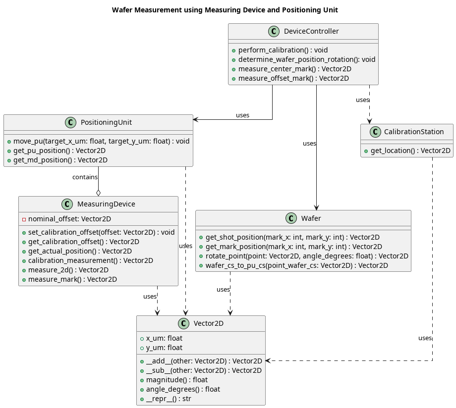

# NFI Device Control Assignment

## Overview
This solution implements a device control system for Nearfield Instruments metrology platform. Using a Positioning Unit (PU) with an integrated Measuring 
Device (MD). The system performs -
1. Calibration
2. Wafer positioning
3. Measurements

## Class Architecture Diagram


## Documentation
1. [Problem Components](./docs/1_problem_components.md)
2. [Solution Approach](./docs/2_solution_approach.md)

## Running Instructions

### Testing

```bash
python3 -m venv venv --prompt=nfc-device-control
source venv/bin/activate
pip install pytest
python -m pytest tests/ -v
```

## Running
```bash
python3 main.py
```